# Analyse, codage et synthèse de la parole par prédiction linéaire (LPC)

Projet académique (MATLAB). TP3 du module **Analyse spectrale des signaux et des systèmes**, Master 1 SIA2 (Signal, Image et Apprentissage Automatique), Université de Toulouse, année 2025–2026. Travail réalisé en binôme par **François Awounang-Ngounou** et **Pavidot Donfack Ananfack**.

On part d'un signal de parole court. On l'**analyse** (audiogramme, phonèmes, transformée de Fourier, spectrogrammes), on le **code** par un modèle autorégressif tranche par tranche (coefficients LPC, puissance, pitch), puis on le **resynthétise** à partir de ces seuls paramètres. Une dernière partie améliore la synthèse par une fenêtre de Hanning avec recouvrement.

---

## Sommaire

1. [Résumé des résultats](#1-résumé-des-résultats)
2. [Structure du dépôt](#2-structure-du-dépôt)
3. [Utilisation](#3-utilisation)
4. [Analyse du signal](#4-analyse-du-signal)
5. [Codage LPC](#5-codage-lpc)
6. [Synthèse](#6-synthèse)
7. [Amélioration : fenêtre de Hanning et recouvrement](#7-amélioration--fenêtre-de-hanning-et-recouvrement)
8. [Limites](#8-limites)
9. [Rapport](#9-rapport)

---

## 1. Résumé des résultats

| Élément | Valeur |
|---|---|
| Fréquence d'échantillonnage | 11 000 Hz |
| Durée d'une tranche | 30 ms (non recouvrantes dans la version de base) |
| Ordre du modèle LPC | P = 12 |
| Intervalle de recherche du pitch | 70 à 600 Hz, soit 18 à 157 échantillons |
| Débit du signal original (8 bits) | 11 000 × 8 = **88 000 bits/s** |
| Débit après codage LPC | (12 + 1 + 1) × 8 = 112 bits par tranche, 112 × 24 = **2 688 bits/s** |
| Facteur de réduction | **supérieur à 30** |

Le signal synthétisé reste relativement intelligible. La fenêtre de Hanning avec recouvrement supprime les grincements aux jonctions entre tranches, au prix d'un débit LPC doublé.

---

## 2. Structure du dépôt

```
src/TP3_Synthese_Parole.mlx   script MATLAB (Live Script) du TP
src/TP3_Synthese_Parole.m     même code exporté en script .m, lisible directement sur GitHub
rapport/                      compte rendu du TP (PDF)
results/                      figures du compte rendu
```

---

## 3. Utilisation

1. Placer le signal `sig.wav` fourni pour le TP dans le même dossier que le script (il n'est pas inclus dans le dépôt).
2. Ouvrir `src/TP3_Synthese_Parole.mlx` dans MATLAB et exécuter les sections dans l'ordre, ou lancer `src/TP3_Synthese_Parole.m`.

Fonctions MATLAB utilisées : `audioread`, `fft`, `spectrogram`, `xcorr`, `toeplitz`, `filter`, `freqz`, `hann`, `sound`.

---

## 4. Analyse du signal

### 4.1 Audiogramme et suppression des silences

Le signal est **non stationnaire** et contient cinq phonèmes. Les parties 1, 3 et 5 sont quasi périodiques (sons **voisés**), les parties 2 et 4 ressemblent à du bruit (sons **non voisés**). Les silences du début et de la fin sont supprimés.

| Audiogramme | Après suppression des silences |
|---|---|
| 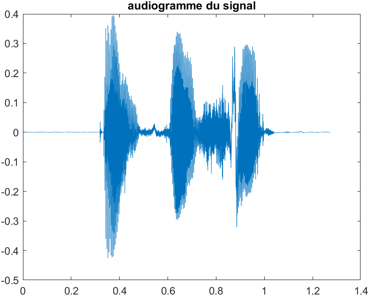 | 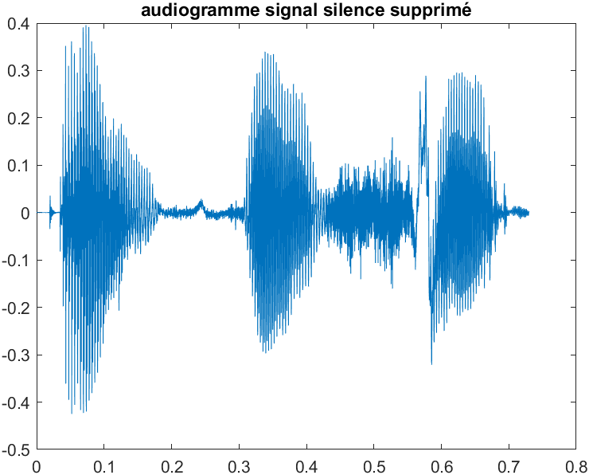 |

### 4.2 Extraction des phonèmes

Chaque phonème est isolé en zoomant sur le signal pour déterminer sa plage.

| a | ch | é | ch | é |
|---|---|---|---|---|
| 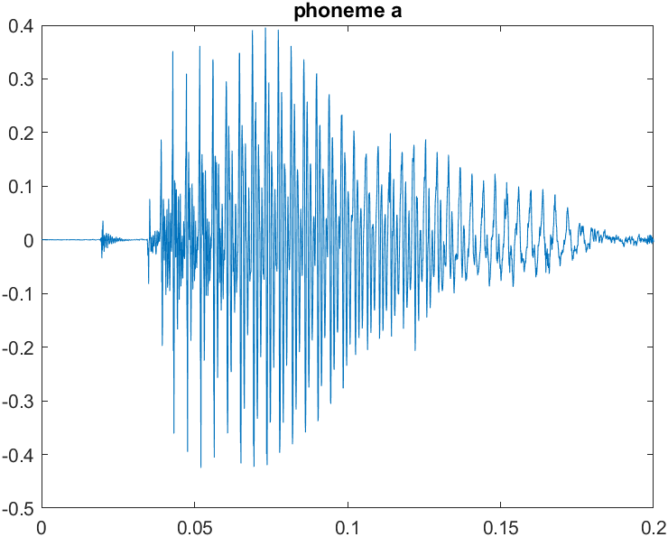 | 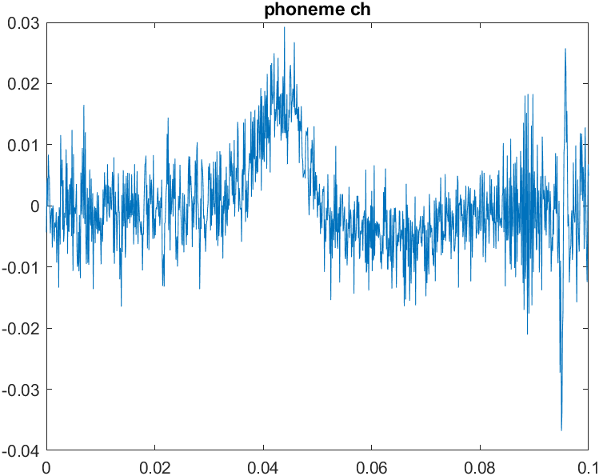 | 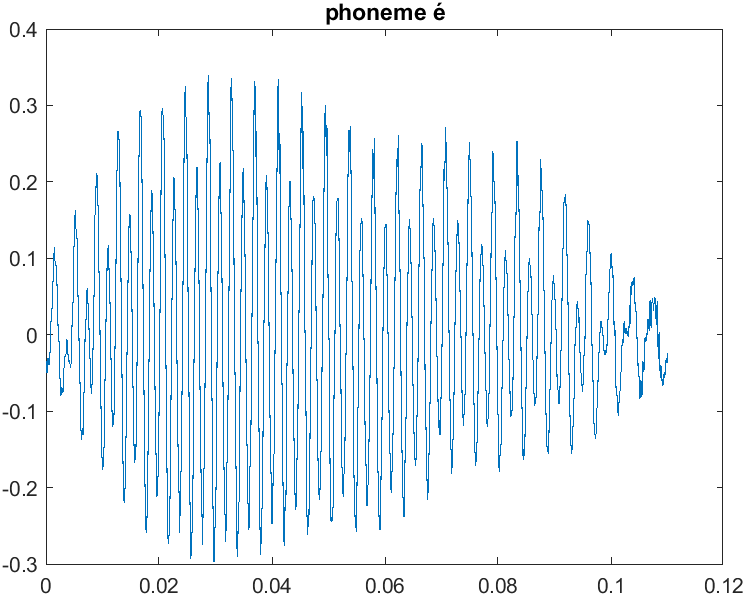 | 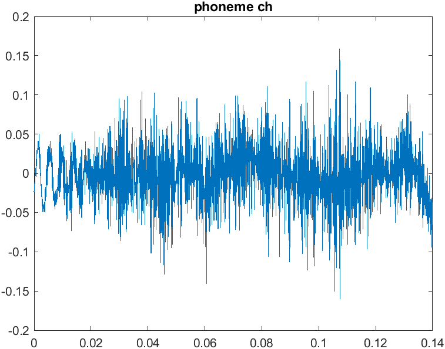 | 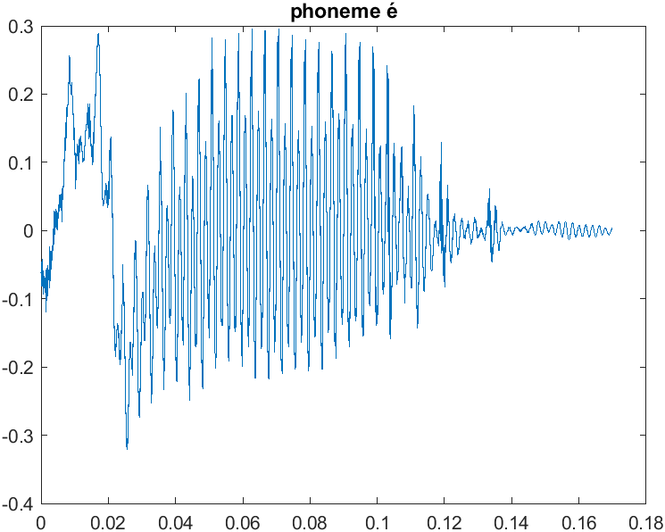 |

### 4.3 Module de la transformée de Fourier

Le spectre montre des composantes périodiques avec leurs harmoniques, mais il ne dit rien de l'agencement temporel de ces fréquences : le signal étant non stationnaire, une analyse **temps-fréquence** est nécessaire.

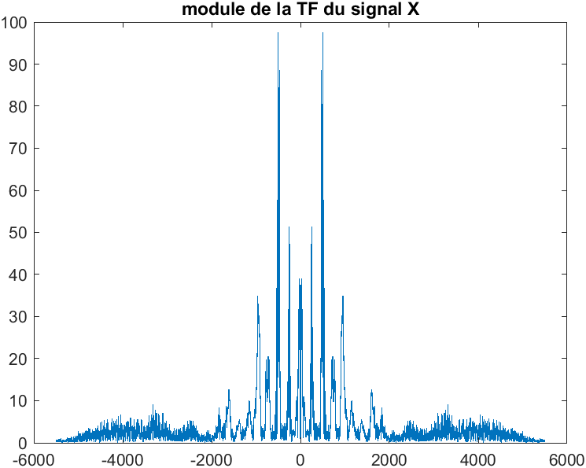

### 4.4 Spectrogrammes à bande étroite et à bande large

| Bande étroite (fenêtre de 0,05 s) | Bande large (fenêtre de 0,01 s) |
|---|---|
| 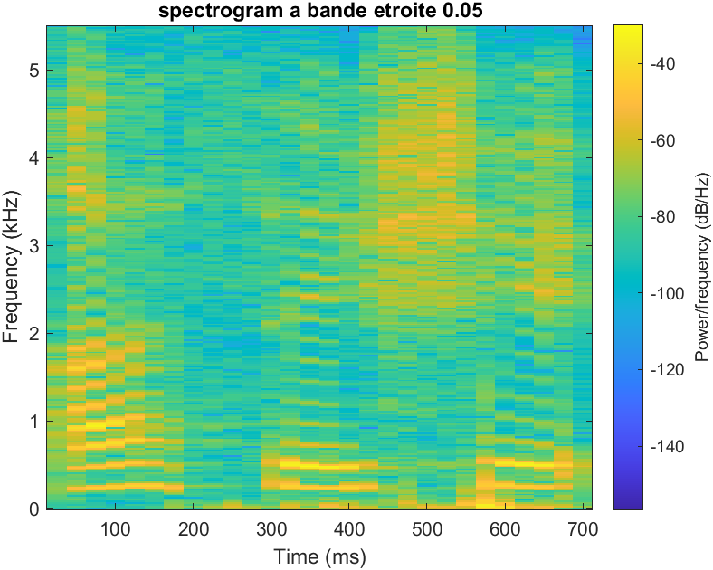 | 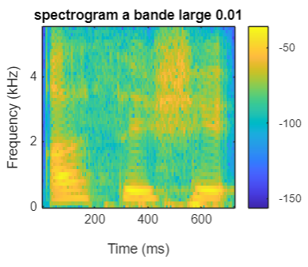 |

- **Bande étroite** : bonne résolution fréquentielle, mauvaise résolution temporelle. On y repère la fréquence fondamentale (environ 250 Hz sur le premier phonème) et ses harmoniques, donc la période pitch.
- **Bande large** : bonne résolution temporelle, mauvaise résolution fréquentielle. On y localise les phonèmes dans le temps.
- Il y a donc un **compromis** à faire entre les deux résolutions. Les phonèmes non voisés n'ont pas de fréquence fondamentale.

---

## 5. Codage LPC

### 5.1 Modèle

Le signal est modélisé par un processus autorégressif d'ordre P :

$$x(n) + a_1 x(n-1) + \dots + a_P x(n-P) = e(n)$$

soit un filtre **tout-pôle** :

$$H(z) = \frac{1}{1 + \sum_{k=1}^{P} a_k z^{-k}}$$

La parole est vue comme la réponse de ce filtre à une excitation $e(n)$ (excitation glottale).

### 5.2 Estimation des coefficients

Minimiser la puissance de l'erreur de prédiction conduit à un système linéaire dont la matrice est une **matrice de Toeplitz** construite sur l'autocorrélation (la démonstration à l'ordre 2, puis l'extension à l'ordre P, sont dans le rapport) :

$$\begin{pmatrix} R_x(0) & \cdots & R_x(P-1) \\ \vdots & \ddots & \vdots \\ R_x(P-1) & \cdots & R_x(0) \end{pmatrix} \begin{pmatrix} a_1 \\ \vdots \\ a_P \end{pmatrix} = - \begin{pmatrix} R_x(1) \\ \vdots \\ R_x(P) \end{pmatrix}$$

### 5.3 Paramètres par tranche

Pour chaque tranche de 30 ms :

| Paramètre | Calcul |
|---|---|
| Puissance moyenne | moyenne des carrés des échantillons |
| Période pitch | position du maximum de l'autocorrélation biaisée entre 18 et 157 échantillons (70–600 Hz) ; mise à 0 pour les tranches non voisées |
| Coefficients LPC | résolution du système de Toeplitz d'ordre 12 |

Le caractère voisé ou non voisé d'une tranche est fixé **a priori**, à partir de la segmentation phonétique : les tranches des 2e et 4e phonèmes sont non voisées.

| Puissance par tranche | Pitch estimé par tranche |
|---|---|
| 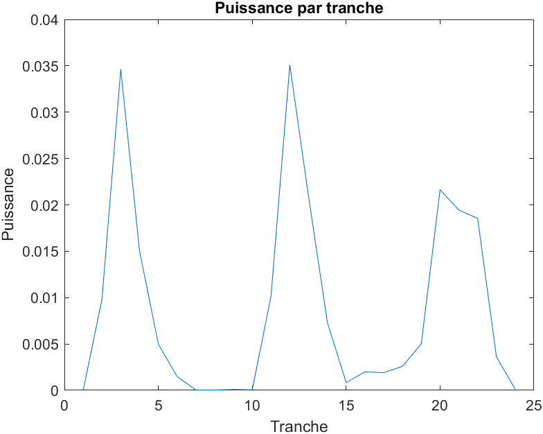 | 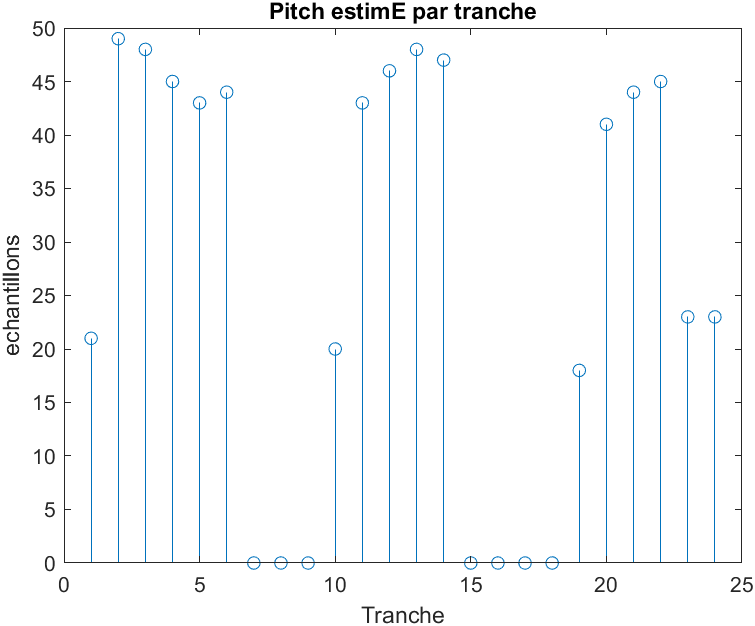 |

La puissance des sons non voisés est quasi nulle, ce qui conforte la segmentation.

---

## 6. Synthèse

Pour chaque tranche :

1. **Source** : bruit blanc si la tranche est non voisée (pitch nul), train d'impulsions périodique de période égale au pitch sinon.
2. **Filtrage** par le filtre tout-pôle de la tranche.
3. **Ajustement de la puissance** à celle de la tranche originale.

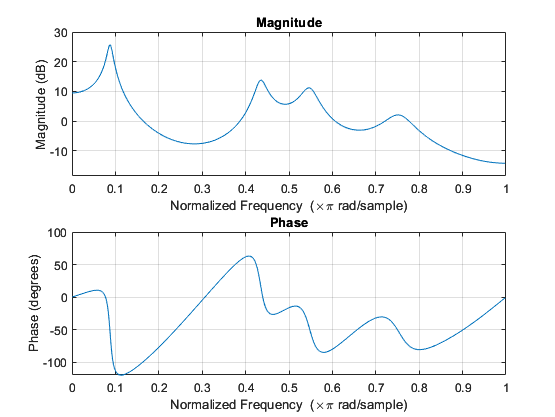

| Audiogrammes | Spectrogrammes |
|---|---|
| 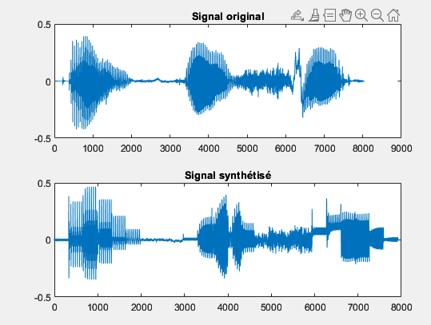 | 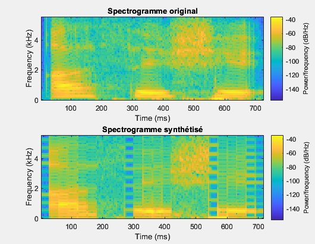 |

Le codage LPC d'ordre 12 reproduit fidèlement la structure du signal. La simplification de la source d'excitation altère les sons non voisés : on utilise un bruit blanc à la place d'un bruit réel, plus complexe à modéliser.

---

## 7. Amélioration : fenêtre de Hanning et recouvrement

Les tranches sont pondérées par une fenêtre de Hanning avec un recouvrement de 50 %, puis recombinées par addition.

| Audiogrammes | Spectrogrammes |
|---|---|
| 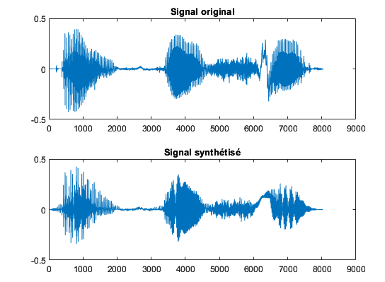 | 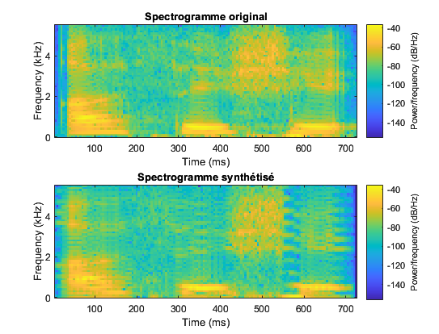 |

La fenêtre s'annule aux extrémités de chaque tranche : les discontinuités aux jonctions disparaissent et la transition entre phonèmes devient progressive. En contrepartie, le nombre de tranches double, et donc le **débit LPC double**.

---

## 8. Limites

- La décision voisé / non voisé n'est pas automatique : elle repose sur une segmentation fixée a priori.
- L'excitation est simplifiée (impulsions parfaites pour les sons voisés, bruit blanc pour les sons non voisés) et ne modélise pas fidèlement l'excitation réelle.

---

## 9. Rapport

Le compte rendu complet, avec les démonstrations, est dans [`rapport/TP3_Awounang_Donfack_analyse_spectrale.pdf`](rapport/TP3_Awounang_Donfack_analyse_spectrale.pdf).
